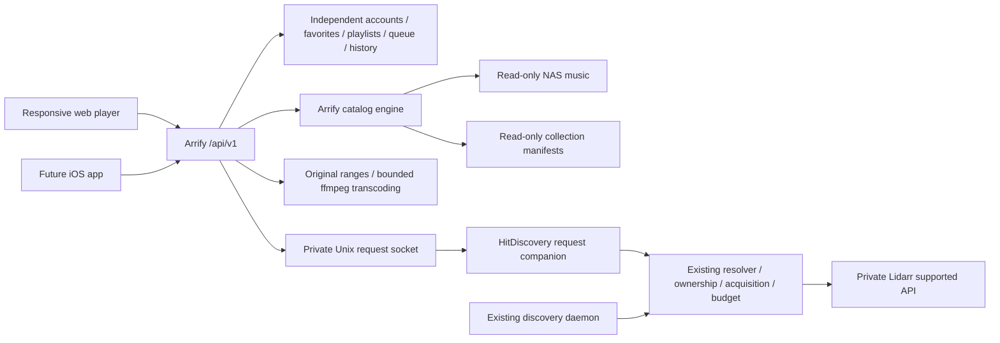

# Architecture and API

`app/accounts.py` owns identity/storage, `app/catalog_engine.py` owns catalog scanning and local artwork, `app/library.py` owns library indexing and playback queues, `app/server.py` owns HTTP API/streaming, and `app/requests.py` is the narrow request client. Browser assets in `web/` depend only on the Arrify API. Catalog access has no separate RPC transport or legacy player service.

The two Docker containers are independent of the legacy stack. Arrify never mounts BBS session/auth sockets or the legacy player database. The only initial catalog access is a consistent `mode=ro` SQLite backup made by deployment. Scans update Arrify's own catalog, preserving its stable integer track identities.

The request companion reuses acquisition service code, configuration and state. Both acquisition processes coordinate through its existing flock and SQLite transaction machinery. Request JSON and status files are durable and atomically replaced. A recording ID deduplicates requests across users; only request IDs belonging to the current user can be queried via the public API. A chosen recording must resolve to the same ID and a suitable official release, otherwise it is held for review. Approved user requests have an operator-authorized per-album funding policy, independent of the temporary background daily cap. A grant for the exact verified payload plus 10% and the transfer reservation commit in one transaction. Unknown sizes, unrelated albums and duplicate release reservations cannot receive funds; failures stay charged and ambiguous writes remain held. This policy does not renew the background allowance, change existing artist monitoring, or start a discography search.

## API v1

All library routes require an approved account. JSON mutation requests must use `Content-Type: application/json` and are size bounded. Web login issues an HttpOnly, SameSite cookie; HTTPS deployment enables Secure. Cookie mutations require the configured Origin and the CSRF token from `/me`. Native bearer tokens are a distinct session kind and do not work as cookies. Tokens are opaque, hashed at rest, expire after seven days, and are revoked by logout. No credentials in URLs or localStorage. Passwords use per-account salts and scrypt. Ordinary signups cannot self-approve or obtain administrator status. A separate initial owner setup form is available only from the real LAN/loopback TCP peer while no administrator exists; it runs in a database transaction and ignores forwarded client headers. Each web Origin must be explicitly allowed and match the request Host. The HTTPS domain gets Secure cookies; explicitly configured direct LAN HTTP origins get host-local HttpOnly/SameSite cookies.

| Method | Path under `/api/v1` | Behavior |
| --- | --- | --- |
| GET | `/setup` | initial owner setup availability |
| POST | `/auth/setup` | LAN-only initial owner creation; disabled after setup |
| POST | `/auth/register` | username/password → pending account |
| POST | `/auth/login` | web cookie login; exact configured Origin required |
| POST | `/auth/token` | native username/password → access_token, token_type, expires_in |
| POST | `/auth/logout` | revoke current session |
| GET | `/me` | account identity, display name, private avatar URL and web CSRF token |
| GET/POST | `/profile` | own display name and optional Gravatar email |
| POST | `/profile/refresh` | invalidate own cached avatar and change its version |
| GET/HEAD | `/avatar/{id}` | authenticated avatar; own account or administrator only |
| GET | `/home` | library counts, collections and current user's recent songs |
| GET | `/search?q=&offset=&limit=` | local songs, artists, albums |
| GET | `/albums`, `/artists` | paginated browsing and name filter `q` |
| GET | `/albums/{id}`, `/artists/{id}` | metadata and tracks |
| GET | `/technical/{id}` | cached duration, sample rate and bit depth |
| GET | `/tracks/{id}` | public track metadata; no local paths |
| GET | `/collections`, `/collections/{slug}` | separate collection sections and available members |
| GET/POST | `/favorites` | current user's favorites; mutate track_id/liked |
| GET/POST | `/playlists` | current user's playlists; create, rename, replace ordered track_ids or delete |
| GET/POST | `/player` | persisted selection, history, stable next and queue |
| GET | `/history` | paginated account listening history |
| GET/HEAD | `/stream/{id}?profile=original` | authenticated bytes/ranges; 206/416 |
| GET | `/stream/{id}?profile=aac\|mp3&start=seconds` | bounded on-demand 192k transcode |
| GET/HEAD | `/artwork/{id}` | authenticated local/cached/fallback art |
| GET | `/discover?q=` | approved-user external metadata lookup |
| POST | `/requests` | selection ID from metadata lookup; durable high-priority request |
| GET | `/requests` | current user's request statuses |
| GET | `/admin/users` | administrator only; approval list |
| POST | `/admin/approve` | administrator only; approve username |

`POST /player` actions: `play` (ids/track_id, collection, or channel), `next`, `previous`, `queue` (ids), `remove` (index), `reorder` (from/to), `clear`, `shuffle`, `position` (seconds). Explicit queues are persisted per user. Channel preview is chosen once, stored, and consumed by next. Previous follows persisted listening history. Starting a channel calls the upstream weighted picker; repeated songs and artists are spaced while repeats can happen before the full collection is exhausted.

## Future iOS

The API supports a Swift client using URLSession and AVPlayer: obtain a bearer token, store it in Keychain, browse using opaque IDs, and attach Authorization to artwork/media requests. Cookie/CSRF details remain confined to web. Native integration still needs device testing, Keychain/auth lifecycle, lock-screen controls, audio session/background modes, AirPlay, playback interruption handling, and App Store policy review. Refresh-token rotation, offline downloads and device handoff are future work, not features claimed by this preview. The web API can evolve behind `/api/v2` without replacing the catalog or identity model.

No paid AI inference, paid music API, Spotify account, or SiriusXM subscription is required by routine playback or local browsing.

## Gravatar profiles

Profiles live in Arrify’s accounts database and preserve existing usernames, authentication and approval roles. Only the current account’s `/profile` response includes its email; `/me`, avatar URLs and approval listings do not expose email addresses or hashes. Gravatar lookup uses the [documented SHA-256 protocol](https://docs.gravatar.com/sdk/images/) against a fixed HTTPS origin, never a caller-supplied URL. Redirects are refused, image responses are size bounded and checked for raster image signatures, and the browser receives the image through an authenticated same-origin endpoint. No Gravatar API key is required.

Successful and missing-avatar lookups are cached for 24 hours; network/provider failures fall back to initials and retry after ten minutes. The photo can be refreshed explicitly. Email changes remove the cached previous photo, and in-flight lookups cannot restore an old photo after a profile changes. Mutation routes retain the existing CSRF/bearer rules and a refresh/update rate limit. Avatar responses vary on Cookie/Authorization and have private caching. The optional address is an image preference, not proof of identity or a recovery credential.

## Native playback decks and installation shell

`web/playback.js` owns two native audio elements: the current stream and at most one prepared next stream. It preserves volume/mute/rate/output when reusing a prepared element, releases the previous stream, and can reuse the original user-activated element if autoplay policy refuses a second element. Queue changes discard obsolete preparation; Data Saver disables speculative transfers. `player.js` obtains the current element through a getter so the compact/expanded views and Media Session continue to control the same active stream. No decoded full-song buffers or private media files are put in Cache Storage.

The browser serializes player mutations. New `next` requests include optional `expected_current`, `expected_next` and `transition_id` fields. Conflicting previews return 409; the browser refreshes and reconciles before playback. Retrying the last transition is idempotent. Position writes include `expected_current` so late saves from an old song cannot overwrite the next song’s position. Existing v1 callers without these optional guards remain supported. Native clients can use the same protocol.

Playback state saves periodically, on pause/seek and on page hide with keepalive. Device volume/quality preferences are stored per account in localStorage; no tokens or credentials are stored there. Reload restores a paused selection and position, and explicit pause cancels autoplay while a Next response is pending. Network/decoder recovery is bounded; unsupported originals can fall back to AAC for the client while originals stay untouched. Media Session exposes transport metadata, position, and playback state.

`manifest.webmanifest`, `install.js`, and `sw.js` provide the installable app shell over HTTPS. Installation is offered in account settings, with browser instructions when a native prompt is unavailable. The worker whitelists public scripts, styling, supplied logos, manifest and offline page. All `/api/` requests, authorization-dependent images and audio/range requests bypass caching. Offline navigation shows an honest offline page. Worker updates do not force a playing tab to reload. LAN HTTP access remains supported; installation/service-worker capabilities require a secure context.

The HTTP server uses a 24-worker pool and a larger accept backlog so an HTTP/2 proxy cannot create an unbounded number of native threads during cover browsing. Queue thumbnails load lazily. Transcoding still permits at most two simultaneous FFmpeg processes, with codec/filter thread counts bounded. These controls affect Arrify only.

Password recovery is disabled until explicitly armed by the operator for one named account. The recovery window lasts ten minutes. Its link can be claimed only by an actual LAN peer with a matching configured Origin/Host; proxy headers cannot enable the claim. The browser carries the token to the HTTPS `/recover` page in a fragment and removes it from the address immediately. Only its SHA-256 digest is stored, with a private expiring grant. Password replacement consumes the grant, revokes all web/native sessions, and preserves the account ID, approval, administrator role and library records. Account renaming likewise preserves identity and related data, rejects name collisions, and revokes old sessions. Neither operation writes to acquisition databases.

`/me` and `/profile` include `text_size` (`standard`, `large`, `largest`). `/profile` accepts this optional field alongside the existing display name and email. Preferences are held in Arrify's own `preferences` table, keyed by the authenticated user's unchanged ID. Old clients can omit the field without resetting a saved size. Validation precedes profile writes; role changes and edits to another user's preferences remain unavailable through this route.

New signup and initial owner setup require `email`. Profile saves require a valid, nonempty email as well. Addresses are trimmed, normalized to lowercase, and checked for account uniqueness within a transaction. An index enforces uniqueness where legacy data permits it; legacy duplicate addresses are preserved and new writes reject conflicts. Existing accounts without an email retain their identity, role, sessions and library data and are prompted to complete their profile. `needs_email` in `/me` reveals only completion status, not the address. `/profile` returns the owner's private email and `email_verified`; saving or changing an address cannot self-verify it. An address change clears its verification timestamp and cached avatar. Email-delivery and ownership-verification flows must be added before email-based recovery is enabled.

Admin-only `/admin/summary` returns a pending count. `/admin/users` returns pending-first accounts, including their email/verification status for administrator review. Both routes retain approved-admin authorization. Ordinary listeners cannot fetch counts or account email lists. The web UI exposes Accounts in the profile menu on phones, a header count badge, and a review notice. Counts refresh on focus, every 30 seconds while visible, and after an explicit approval. No pending account is approved automatically by this change.

## Playback recovery and navigation

The active media element carries its actual playback profile and transcode start offset. Native media duration takes priority for original files; full-file metadata supplies duration for offset transcodes. Invalid estimates are shown as unknown instead of pinning a playing song to 100%. A recovery checkpoint survives an error that resets the native clock to zero. Original-file recovery waits for metadata and completion of the seek before play. Pending seeks can be cancelled by a replacement request or pause. Delayed media events are checked against the element's actual paused/error/ended state; a quality change preserves playback intent while a prior seek is pending.

Safari/iOS retains one media element and skips speculative second-deck loading. Desktop browsers can continue using a prepared native deck; a connected wireless route keeps its active element. These are native streaming transports, with no sample-accurate gapless claim. Mobile Queue is a `#queue` view; navigation leaves it normally. Desktop Queue remains a side panel that closes on route changes. The phone mini-player's thin line is a progress indicator, with deliberate seeking in expanded Now Playing.

Authenticated/CSRF-protected `POST /player/diagnostics` keeps a bounded, sanitized private event snapshot per account under `/data/playback-diagnostics/`. Only numeric clock/status fields and fixed event/profile names are retained. No URLs, login tokens, cookies, addresses, or audio content are accepted. A fixed system record can capture a denied audio request to help diagnose detached-receiver authentication. Events are size/rate bounded, private files use mode 0600, and no diagnostic upload controls playback. Unexpected backward clock reports are recorded without forcing a seek; real error recovery uses the checkpoint, and legitimate native/Media Session seeks remain allowed.

Unsupported seek handling is explicit. A rejected seek to zero on an original source reloads that track from the beginning on the same media element. Rejected nonzero seeks use the existing offset-transcoded compatibility path (AAC, or MP3 if AAC was rejected), preserving playback intent and the requested position. Runtime quality controls show the actual fallback. Original media remains unchanged. If all attempts fail, the checkpoint remains available and the user receives actionable output guidance. Stale play rejections from replaced sources are treated as cancellation. Player notices are rendered inside expanded Now Playing as well as the ordinary toast area, so a modal cannot hide the recovery explanation.

## Search lifecycle and recent searches

The search field is a transient draft. Navigation away from Search clears it and cancels pending search/history timers, including selection of the current bottom tab. Explicit Search navigation opens a fresh field. The clear button clears the draft without deleting recent searches. Delayed local/external results cannot overwrite a newer query or a different view.

Authenticated `GET /search/history` and CSRF-protected `POST /search/history` store/retrieve the current account's latest 20 queries in Arrify's own `search_history` table. POST actions are `remember`, `remove`, and `clear`; an optional body `user_id` cannot change the authenticated scope. Queries are bounded to 200 characters, whitespace-normalized, case-insensitively deduplicated, and ordered by most recent use. Submitted or settled searches are recorded, not every input event. Rows can be recalled or removed, and the entire history can be cleared. History follows the account across devices; query text is escaped for display and never enters playback commands or acquisition submission logic.

### Sound processing and desktop gapless preview

`app/sound.py` owns `/data/sound.db` measurements and account sound preferences. One lazy analysis worker, 128 queued jobs, ten-minute per-file timeout, one-hour failed-analysis retry backoff. Analysis is resumable via its file-keyed cache; pending jobs are repopulated on demand after restart. Sources are opened read-only. Playback gain is linear (no compression), target -16 LUFS, true-peak headroom -1 dBTP, boost capped +12 dB. Album gain is a duration-weighted track-energy estimate, with the highest album peak controlling headroom; it preserves between-track dynamics. Silence receives zero gain. A pending analysis never blocks playing a song. Gain changes take effect on a later load, not halfway through a song. Native speculative preload is disabled while leveling is on, avoiding reuse of unmeasured native buffers. `GET/POST /api/v1/sound` are account scoped; `GET /api/v1/sound/<track>?mode=track|album` only accepts locally playable tracks. Cookie writes require CSRF/origin; native bearer tokens use the same account scope.

Streaming now supports leveled FLAC/AAC/MP3 and bounded PCM rendering through the existing two-process transcoder semaphore. Linear gain is recalculated from trusted cached measurements, never a caller-supplied arbitrary FFmpeg filter. Leveled Original playback is rendered FLAC, not a byte-identical original file transfer. Unleveled original range streaming remains unchanged. The PCM endpoint renders stereo 16-bit / 44.1 kHz, rejects known durations over 280 seconds, and is authenticated, private, and uncached.

`web/gapless.js` is an optional desktop AudioContext transport. Two AudioBufferSourceNodes are scheduled at the same sample boundary using the audio clock; this is distinct from native preloading or a crossfade. The already scheduled next node is adopted after the backend's expected-current/next transition is acknowledged, preserving backend queue/history authority. Queue changes cancel the scheduled next source. Pausing/seeking rebuilds the schedule from a saved offset. Decode requests are canceled on replacement; each encoded response is bounded to 48 MiB and decoded buffer to 96 MiB. Buffers never enter browser persistent storage. Preview is disabled for iOS, Safari's AirPlay-capable media elements, Data Saver, and non-Original profiles. A rejected current decode falls back to native playback. Missing/late next buffers are explicitly not guaranteed gapless. The preview is not certified for background/lock-screen use or physical AirPlay.

References: [FFmpeg loudness filters](https://ffmpeg.org/ffmpeg-filters.html#loudnorm) and [Web Audio scheduled sources](https://www.w3.org/TR/webaudio/#AudioScheduledSourceNode).

### Ranked local search

`app/search.py` builds immutable per-kind indexes from Arrify's available public track/album/artist snapshot during `Library.reindex`. Search requests no longer hold the scanner's SQLite lock or perform full catalog SQL LIKE scans. Unicode casefold/NFKD normalization removes accents, folds apostrophes and punctuation, and supports compact spellings such as ACDC. Candidate songs must match all query terms across song/artist/album fields; whole-field compact aliases also match. Exact fields rank ahead of phrases/prefixes, then term evidence, with deterministic normalized-field and ID ties. Albums and artists are independently ranked without exposing their internal track-ID arrays.

Typo fallback runs only when strict candidates are absent. It allows one insertion/deletion/substitution or adjacent transposition for words of four or more characters, at most 12,000 vocabulary checks and 24 expansions per token, up to 16 query tokens and 200 input characters. Local search is account-rate-limited to 180 requests/minute. Empty queries return no results. Returned `fuzzy` marks close matches explicitly. A deterministic index revision prevents mixing song pages across metadata/catalog changes; the client restarts the search when the revision changes. New query/page replies still check the route epoch and current text before modifying results. No search traffic is sent to external providers unless the user chooses catalog search.

### Missing-content song and album requests

The private request companion now recognizes exact artist-name searches before recording lookup. A recognized artist is searched by MusicBrainz artist ID, avoiding songs merely named after that artist (the Merle Haggard regression). Other queries combine song-title and artist terms safely rather than sending an unscoped Lucene string. Candidate versions are ranked and duplicate title/artist/version rows are collapsed. Relative provider scores are not treated as identity-confidence thresholds: actual artist/title agreement and joint credits outrank title mentions by other artists. For a clear artist/song pair, a structured same-name-album query is used as an additional search lead, with every returned recording/album link still independently verified. Album candidates come from MusicBrainz releases explicitly browsed by recording ID, with official-release/type/artist/date checks and preference for original non-deluxe albums over EPs/singles. Existing compilation/live/remix exclusions remain in place.

Search returns up to six cards per batch, with More matches and bounded verification work. Provider calls respect the shared request clock, cache successful metadata/results, retry transient failures once, and use an overall 45-second search budget with eight-second individual reads. Partial provider failures retain already verified rows and allow retry of remaining matches; they are not mistaken for a verified absent album. A bounded eight-worker Unix server lets unrelated status/submission calls proceed while a lookup waits; submission creation remains serialized to preserve durable deduplication. No TCP metadata/Lidarr endpoint is added.

Each requestable result is pinned to a recording and release group using an opaque UUID selection cached by the companion. The submitted inbox snapshot includes the verified release IDs, album title and recording identity. New requests use that pinned resolution instead of performing a later broad artist/title lookup that could change the displayed album. Existing legacy inbox entries retain their prior resolver path. Public search strips the internal resolved payload, and status includes the selected album alongside song and artist. Searching never submits a request or grants download allowance; the existing approved-request ownership, priority, exact-size authorization, reserve, quality and acquisition rules run after explicit submission. No other companion acquisition modules changed from the running baseline.

Provider contract reference: https://musicbrainz.org/doc/MusicBrainz_API and https://musicbrainz.org/doc/MusicBrainz_API/Search .

## Administration

Profile → Admin provides overview, accounts, requests and library storage. Every administration API checks the authenticated administrator; account mutations also recheck the actor inside the transaction. Freezing revokes browser/native sessions, blocks sign-in, invalidates recovery grants and stops future authorized media reads. Foreground web clients recheck access every 20 seconds. Already buffered audio cannot be recalled; iOS can suspend background JavaScript.

Deletion requires the exact username. Personal playlists, saved songs, history, preferences, profile, sessions and diagnostics are removed. A non-login anonymized user-ID tombstone prevents ID reuse; shared acquisition request references remain and display Deleted account. Self-freeze/deletion and removal of the last active administrator are blocked. Administrative account actions are audited. Login/activity timestamps begin with this release; listening counts represent tracks started, not completion or listening minutes.

Request views join Arrify's per-user registry with the companion's private Unix-socket bulk status endpoint. New submissions keep a title/artist/album snapshot so unavailable status does not erase their identity. Background discovery and request authorization rules remain in the companion.

Library storage displays configured paths, read-only container mappings, indexed counts/bytes and filesystem capacity. Its folder picker stays within approved mappings and excludes symlink traversal. Adding/removing a location changes indexing configuration, never music files. A new host path outside these mappings requires a read-only deployment mount; the player cannot administer Docker or mount arbitrary storage.

## Personal and shared playlists

Personal playlists now carry visibility (`private` by default, including all existing rows). Shared means discoverable and playable by approved signed-in Arrify listeners, not public internet access or collaborative editing. The Library has a Shared playlists section with creator attribution. Reads by ID enforce ownership or shared visibility; every mutation requires ownership, including sharing, deleting and adding songs. Frozen/deleted creators' shared playlists are hidden. Changing back to private removes other listeners' playlist access; the underlying common music library remains available to approved users.

The versioned API keeps GET /playlists as the caller's editable collection, adds GET /playlists?scope=shared and GET /playlists/:id, and accepts visibility plus atomic add_track_id on POST /playlists. Track additions deduplicate under a database transaction. The expanded player and song rows have a visible + playlist picker; the heart remains Liked songs. Create-and-add is a single request, with explicit private/shared selection. No audio files, collection manifests or acquisition behavior change.

## Library and song actions

The Library destination groups Liked songs, personal playlists, community shared playlists and recent listening. Browse playlists remains the generated collection destination, with albums/artists/moods available independently. Mobile Library navigation points to #library; favorites/history/personal detail keep it selected. These pages reuse existing scoped APIs and retain playlist visibility enforcement.

Song rows and queue entries expose a single ellipsis action, and expanded Now Playing keeps its frequent heart control beside an ellipsis. A labeled native dialog presents only supported actions: like/unlike, add to playlist, add to queue, go to queue, go to album and go to artist. Song identity is fetched by ID before opening the dialog; navigation dismisses the expanded player as needed, while playlist selection can remain above it. No public sharing, recommendations, hiding or other unsupported provider controls are implied.

Design references: https://support.spotify.com/us/article/your-library/ ; https://support.spotify.com/us/article/now-playing/ ; https://support.apple.com/en-ie/111118 . These support grouping favorites/playlists in Library and combining frequent save controls with secondary options in More. Arrify's particular grouping is a design decision, not a formal industry standard.

## Shared listening sessions

The account owns one desired listening state; one page instance owns media output. Other authenticated pages control that account's output and never start speculative local audio. New navigation gets a fresh tab ID, preventing duplicated tabs from impersonating the same active output. A navigation classified as reload restores that tab’s sessionStorage ID, then reattaches only if it still owns the session. Reattach checks owner, epoch and revision; advances the epoch to fence the old page; preserves queue, station and play identity; and resumes at the confirmed cursor without projecting refresh time. Paused sessions remain paused. Browser autoplay rejection records needs-gesture and exposes primary Play. Pagehide sends a best-effort keepalive checkpoint; monotonically increasing per-epoch report numbers reject out-of-order observations. Remote online status expires locally even if no new snapshot arrives. Primary Play explicitly takes over an expired output. No tab guesses ownership from a device name. Play here is an explicit fenced takeover, carrying the current queue/station and last acknowledged position. Browsing remains independent on each screen.

`GET /api/v1/listening` returns the authoritative snapshot. `?revision=N` returns a compact position/status response when the queue/control revision is unchanged. `POST /api/v1/listening` supports existing play/queue/channel actions plus pause, resume, seek, takeover, reload reattach and owner heartbeat. Control mutations require `device_id` and `expected_revision`; owner heartbeats check device/epoch and intent, and automatic advancement also checks `owner_epoch`. A stale mutation receives 409 and the UI refreshes instead of replaying it. Existing next-transition IDs remain idempotent. Distinct intent and seek versions preserve the final seek when several actions are coalesced while an output is asleep. Unsent obsolete selections/seeks are coalesced in the client. HTTP mutations are not blindly retried.

Desired transport/queue is stored in the existing player JSON. Frequent observed position, duration, profile, quality, output and acknowledgement live in a small `listening_status` row in Arrify's accounts database. Heartbeats do not rewrite the queue. Playback history is recorded once when output confirms a selected play, not for intermediate selections that a sleeping output never played. Existing history is retained. Account deletion removes both its player and listening status.

`GET /api/v1/listening/events` is an authenticated SSE invalidation stream. A notification contains a small sequence value; clients fetch database state rather than replay a command log. Notifications publish only after commit. The in-process hub is disposable; durable state survives restart and clients re-read on reconnect. SSE connections are bounded to eight globally/four per account, reserving sixteen of twenty-four HTTP workers for normal traffic; excess connections fall back to polling. Keepalives/authentication checks run at ten-second intervals and connections recycle after about 110 seconds. A future multi-process deployment should add a shared notifier; the database and fallback reads remain authoritative.

Healthy live clients use periodic 15-second verification in addition to push. Fallback reads begin at 2.5 seconds and back off to 30 seconds on failures. Offline/hidden controller pages stop background connections; active media output retains its connection when the browser permits. Initial opening, focus, visibility restoration, pageshow, online and SSE reconnect trigger immediate reads. Progress uses server-relative timestamps and a bounded local estimate, avoiding dependency on device clocks.

Media URLs carry device/epoch fencing. New reads from a displaced output are rejected and active server transfers recheck ownership about once a second. The losing foreground page stops and relinquishes its Media Session. Bytes already buffered at a receiver cannot be recalled. Safari/iOS can suspend page JavaScript and SSE; pending controls then apply when the page wakes. This is browser-based synchronized control, not proof of native background execution or a hardware-validated AirPlay handoff. Future iOS clients can use the same versioned account, state, intent, acknowledgement and stream-ownership protocol with a native playback layer.

Legacy GET /player remains readable through the shared state adapter. Legacy POST /player requires a client refresh once a session has a playback owner, preventing old tabs from overwriting current progress.

Logout includes a fenced departure: the account transaction revokes the login and releases output only if the departing device/epoch still owns it. It preserves the confirmed song/cursor/queue, increments epoch/control versions and records paused state before publishing invalidation. A controller logout leaves another output untouched. Late heartbeat and old media URLs fail ownership checks. Local playback/polling is suppressed while sign-out completes.

Local output controls invoke the browser picker directly in the original click gesture, bypassing hidden-button forwarding and the session-transfer dialog. Remote controls still show session options for explicit takeover. Output observes WebKit availability and wireless-route changes; it never manufactures a list of OS AirPlay devices or claims a room name the browser does not expose.

Automatic end-of-song advancement has bounded transient-failure recovery independent of online events. Retry re-reads state, reuses the same transition ID, checks original current song/owner epoch, and stops after pause, takeover or a superseding selection. A lost committed response is reconciled rather than treated as a new Next. Retries are bounded (three delayed attempts); exhaustion exposes Play/Next retry and numeric diagnostics. This cannot execute while iOS suspends page JavaScript.

## Request progress and in-app notifications

An Arrify-owned background observer reads companion statuses in batches every 30 seconds and wakes after submission. It never submits downloads or changes acquisition policy. Request pages read small saved observations rather than blocking on the companion. Progress retains transition history and the last known state during an outage. Unknown transfer percentage/ETA is not invented: a submitted album search is labelled Acquiring, not proof of active download.

Ready requires a normalized exact artist/album/song match in the available player index and the existing media-file availability/size check. Filesystem checks run outside account transactions and once per matching file per observation cycle. Upstream imported/available alone remains Library check. Library scanning cadence still bounds when new files enter the index; a notification confirms the requested song, not necessarily every track of the album. Conservative matching can leave an edition/tag mismatch at Library check rather than notifying about a different release.

`request_progress` stores the latest private observation, `request_events` stores observed state transitions, and `request_notifications` stores one availability notice per account/request plus its read timestamp. Account deletion purges these records while retaining existing acquisition request references. The worker rechecks account existence within its transaction so a concurrent deletion cannot recreate private records. An index/file disappearance removes playback links while retaining the historical notification. GET /requests and /notifications are authenticated and account-scoped; POST /notifications/read requires the existing origin/CSRF protection and only acknowledges that account's notices. Older /request-notifications routes remain compatible with prior open clients.

The top-bar bell exposes recent notices, unread counts, Play song and View album. Read state persists across devices/sign-ins; Play affects the existing shared listening session and never auto-starts merely because music arrives. Visible pages refresh notifications every 30 seconds and on focus/wake. Request cards refresh changed observations without disturbing an open timeline. These are in-app notifications, including notices retained while the browser is closed; Web Push, OS background alerts and email delivery are not implemented in this release.

When the companion reports a live `phase` (downloading/paused/importing/import-error), that phase refines the request state. A finite reported transfer percentage in [0,100] may be displayed for downloading/paused; its absence clears cached progress rather than retaining a misleading number. No percentage is inferred from the stage indicator.

### Responsive playback frame

The expanded player reserves height for seek/transport and the source/output footer. Metadata can scroll independently, and artwork takes the remaining space. A short-landscape grid shares header/tabs and queue heading/transport rows instead of squeezing the portrait stack. Resize/visual-viewport observers recalculate art and clear stale scroll/size overrides when the layout changes; they do not replace the media element or fetch playback state merely because the device rotates. The full orientation matrix is documented in VERIFICATION.md.
